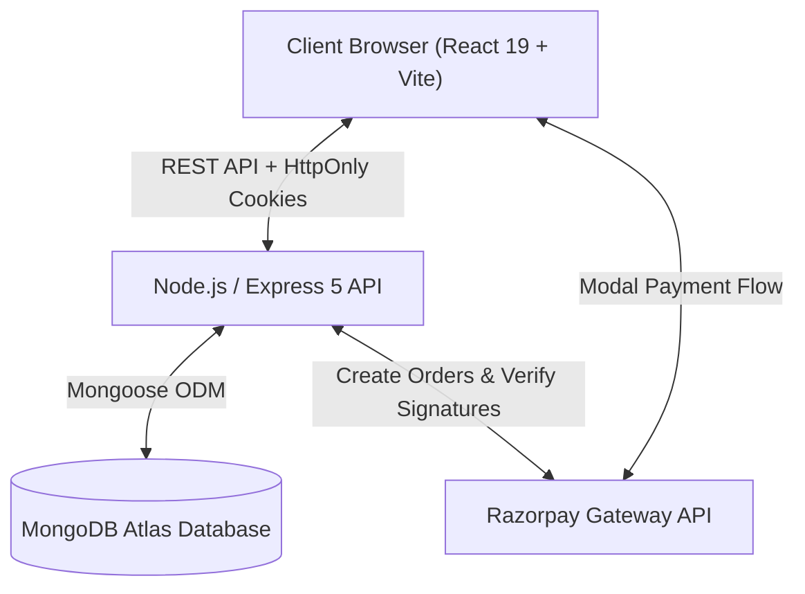

# 🛍️ ShopKart — Full-Stack MERN E-Commerce Platform

[](https://shopkart-frontend-nine.vercel.app)
[](https://react.dev/)
[](https://react.dev/)
[](https://nodejs.org/)
[](https://expressjs.com/)
[](https://www.mongodb.com/atlas)
[](https://razorpay.com/)

> 🌐 **Live Website**: [https://shopkart-frontend-nine.vercel.app](https://shopkart-frontend-nine.vercel.app)

ShopKart is a production-grade, full-stack e-commerce web application engineered with the **MERN** stack (MongoDB, Express.js, React 19, Node.js) and powered by Vite. It implements complete customer authentication, dynamic product catalog management, persistent wishlists, interactive cart operations, and end-to-end checkout with Razorpay payment gateway integration and cryptographic signature verification.

---

## 📑 Table of Contents

- [Features & Lab Coverage](#-features--lab-coverage)
- [System Architecture](#-system-architecture)
- [Tech Stack](#-tech-stack)
- [Project Directory Structure](#-project-directory-structure)
- [Getting Started Locally](#-getting-started-locally)
  - [Prerequisites](#prerequisites)
  - [1. Clone Repository](#1-clone-repository)
  - [2. Backend Setup](#2-backend-setup)
  - [3. Frontend Setup](#3-frontend-setup)
- [Environment Variables](#-environment-variables)
- [API Reference](#-api-reference)
- [Deployment Guide](#-deployment-guide)
- [Security & Best Practices](#-security--best-practices)
- [Submission Checklist](#-submission-checklist)

---

## ✨ Features & Lab Coverage

The project fulfills all requirements across **Labs 1 to 6**:

| Lab | Milestone | Key Capabilities Implemented |
|---|---|---|
| **Lab 01** | **Customer Authentication (Backend)** | Password hashing with `bcrypt` (salt rounds: 10), JWT token creation, secure `HttpOnly` cookie distribution, and authenticated route middleware. |
| **Lab 02** | **Client-Server Authentication (Frontend)** | React authentication context (`AuthContext`), persistent session checking (`/customers/me`), protected routing, and responsive Login/Register UI. |
| **Lab 03** | **Product Catalog** | Product schema with stock limits, category filtering, search queries, pagination, detailed product view, and automated database seeding on server startup. |
| **Lab 04** | **Wishlist System** | Add/remove and toggle wishlist actions, dedicated Wishlist view, and badge indicators in navigation. |
| **Lab 05** | **Shopping Cart** | Real-time quantity adjustments, stock availability validation, subtotal calculation, free delivery thresholds, and optimistic UI updates. |
| **Lab 06** | **Checkout & Payment Gateway** | Real-time order creation with Razorpay API, checkout modal integration, cryptographic HMAC SHA-256 payment signature verification, and order history view. |

---

## 🏛️ System Architecture



---

## 💻 Tech Stack

### Frontend
- **Framework**: [React 19](https://react.dev/) with [Vite](https://vite.dev/)
- **Routing**: [React Router v7](https://reactrouter.com/)
- **HTTP Client**: [Axios](https://axios-http.com/) (configured with `withCredentials: true`)
- **Icons**: [Lucide React](https://lucide.dev/)
- **Styling**: Vanilla CSS (modular design tokens, glassmorphism, responsive grid)

### Backend
- **Runtime**: [Node.js](https://nodejs.org/) (ES Modules)
- **Framework**: [Express.js 5](https://expressjs.com/)
- **Database ODM**: [Mongoose](https://mongoosejs.com/)
- **Security**: [bcrypt](https://www.npmjs.com/package/bcrypt) & [jsonwebtoken (JWT)](https://jwt.io/)
- **Payment Processing**: [Razorpay SDK](https://razorpay.com/docs/)

---

## 📁 Project Directory Structure

```text
mern lab/
├── backend/
│   ├── config/             # Razorpay configuration
│   ├── controllers/        # Request handlers (auth, product, cart, wishlist, order)
│   ├── middlewares/        # JWT customer authentication middleware
│   ├── models/             # Mongoose schemas (Customer, Product, Order)
│   ├── routes/             # Express API route declarations
│   ├── utils/              # Token generation & helper utilities
│   ├── .env.example        # Backend environment variables template
│   ├── index.js            # Express server entry point & DB connection
│   └── package.json
├── frontend/
│   ├── public/             # Static public assets
│   ├── src/
│   │   ├── components/     # Navbar, Footer, and reusable UI components
│   │   ├── context/        # AuthContext for global user state
│   │   ├── pages/          # Home, Products, ProductDetails, Cart, Wishlist, Checkout, Orders
│   │   ├── services/       # Centralized Axios API client (api.js)
│   │   ├── App.jsx         # App routing setup
│   │   ├── main.jsx        # React root entry
│   │   └── index.css       # Core stylesheet & design system
│   ├── .env.example        # Frontend environment variables template
│   ├── vercel.json         # SPA rewrite configuration for Vercel
│   └── package.json
├── .gitignore              # Root gitignore (protects secrets & node_modules)
└── README.md
```

---

## 🚀 Getting Started Locally

### Prerequisites
- [Node.js](https://nodejs.org/) (v18.0.0 or higher recommended)
- [MongoDB Atlas](https://www.mongodb.com/cloud/atlas) account (or a local MongoDB instance)
- [Razorpay Test Account](https://dashboard.razorpay.com/) (for Key ID and Secret)

---

### 1. Clone Repository

```bash
git clone https://github.com/Atharva2710/ShopKart.git
cd ShopKart
```

---

### 2. Backend Setup

1. Navigate to the backend directory and install dependencies:
   ```bash
   cd backend
   npm install
   ```

2. Create your `.env` configuration:
   ```bash
   cp .env.example .env
   ```

3. Fill in your environment variables inside `backend/.env`:
   ```env
   PORT=8085
   NODE_ENV=development
   dbUrl=your_mongodb_atlas_connection_string
   jwt_secret=your_jwt_secret_key
   RAZORPAY_KEY_ID=your_razorpay_key_id
   RAZORPAY_KEY_SECRET=your_razorpay_secret_key
   FRONTEND_URL=http://localhost:5173
   ```

4. Start the backend development server:
   ```bash
   npm run dev
   ```
   *The server will start at `http://localhost:8085` and automatically seed initial sample products into MongoDB if the collection is empty.*

---

### 3. Frontend Setup

1. Open a new terminal, navigate to the frontend directory, and install dependencies:
   ```bash
   cd ../frontend
   npm install
   ```

2. (Optional) Create a `.env` file if you want to override defaults:
   ```bash
   cp .env.example .env
   ```
   *By default, the client points to `http://localhost:8085` if no `VITE_API_BASE_URL` is provided.*

3. Start the Vite development server:
   ```bash
   npm run dev
   ```

4. Open your browser and navigate to `http://localhost:5173`.

---

## 🔐 Environment Variables

| Variable | Location | Description | Example / Default |
|---|---|---|---|
| `PORT` | Backend | Port on which the Express server listens | `8085` |
| `NODE_ENV` | Backend | Current environment (`development` or `production`) | `development` |
| `dbUrl` | Backend | MongoDB connection string URI | `mongodb+srv://...` |
| `jwt_secret` | Backend | Secret key used to sign and verify JWT tokens | `your_secret_key` |
| `RAZORPAY_KEY_ID` | Backend | Public Key ID from Razorpay Dashboard | `rzp_test_...` |
| `RAZORPAY_KEY_SECRET` | Backend | Secret Key from Razorpay Dashboard | `your_secret` |
| `FRONTEND_URL` | Backend | Frontend origin URL for CORS policy | `http://localhost:5173` |
| `VITE_API_BASE_URL` | Frontend | Target backend API base URL | `http://localhost:8085` |
| `VITE_RAZORPAY_KEY_ID` | Frontend | Razorpay Key ID for client checkout popup | `rzp_test_...` |

> ⚠️ **Important**: Real `.env` files are ignored by git and must never be committed to source control.

---

## 📡 API Reference

### Customer Authentication
- `POST /customers/register` — Register a new customer
- `POST /customers/login` — Authenticate and receive `HttpOnly` JWT cookie
- `GET /customers/me` — Retrieve authenticated customer profile
- `POST /customers/logout` — Invalidate session and clear auth cookie
- `PATCH /customers/change-password` — Change password for authenticated user

### Product Catalog
- `GET /products` — Fetch products with optional `search`, `category`, and `sort` query params
- `GET /products/:id` — Retrieve detailed product information

### Wishlist Management
- `GET /wishlist` — Get authenticated user's wishlist
- `POST /wishlist/:productId` — Add product to wishlist
- `DELETE /wishlist/:productId` — Remove product from wishlist
- `PATCH /wishlist/:productId/toggle` — Toggle product in/out of wishlist

### Shopping Cart
- `GET /cart` — Get active shopping cart with product population
- `POST /cart/:productId` — Add product to cart
- `PATCH /cart/:productId` — Update item quantity (`{ quantity }`)
- `DELETE /cart/:productId` — Remove product from cart

### Orders & Payments
- `POST /orders/create-payment-order` — Create a Razorpay order from active cart
- `POST /orders/verify-payment` — Verify cryptographic HMAC payment signature & record order
- `GET /orders` — List past orders for authenticated user
- `GET /orders/:id` — Get single order details

---

## 🌐 Deployment Guide

### Deploying the Backend (Render / Railway)
1. Push this repository to GitHub.
2. Create a new **Web Service** on [Render](https://render.com/) or [Railway](https://railway.app/).
3. Connect your repository `Atharva2710/ShopKart`.
4. Configure service settings:
   - **Root Directory**: `backend`
   - **Build Command**: `npm install`
   - **Start Command**: `npm start`
5. Add your Environment Variables in the service settings (`dbUrl`, `jwt_secret`, `RAZORPAY_KEY_ID`, `RAZORPAY_KEY_SECRET`, `NODE_ENV=production`, `FRONTEND_URL=https://your-frontend.vercel.app`).

### Deploying the Frontend (Vercel / Netlify)
1. Create a new project on [Vercel](https://vercel.com/) and import `Atharva2710/ShopKart`.
2. Configure project settings:
   - **Framework Preset**: `Vite`
   - **Root Directory**: `frontend`
   - **Build Command**: `npm run build`
   - **Output Directory**: `dist`
3. Add Environment Variables:
   - `VITE_API_BASE_URL`: `https://your-backend-service.onrender.com`
   - `VITE_RAZORPAY_KEY_ID`: `your_razorpay_key_id`
4. Deploy! The included `vercel.json` automatically handles single-page routing rewrites.

---

## 🔒 Security & Best Practices

- **Zero Credentials in Git**: `.env` and secret files are strictly excluded via `.gitignore`.
- **HttpOnly Cookies**: Session tokens are stored in `HttpOnly` cookies to protect against Cross-Site Scripting (XSS).
- **Cryptographic Signature Verification**: Razorpay payment callbacks verify authenticity server-side using HMAC SHA-256 before confirming any order.
- **Stock Re-verification**: Quantities and prices are re-checked against the database at checkout time to prevent client-side tampering.

---

## ✅ Submission Checklist

- [x] GitHub repository link with latest code (`Atharva2710/ShopKart`)
- [x] Complete frontend and backend implementations (Labs 1–6)
- [x] Working database integration (MongoDB Atlas)
- [x] Setup instructions & documentation in `README.md`
- [x] No API keys, secrets, or `.env` files pushed to GitHub
- [x] Verified build (`vite build` passes with zero errors)
